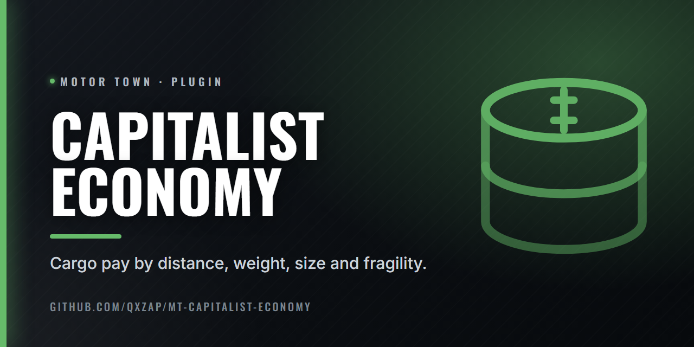

  

# Capitalist Economy

Cargo pay by straight-line distance, weight, size and fragility.

Paid distance is the average of the road and the full straight line between pickup and drop-off (`RoadShare`, default 0.5), adjusted by real weight, size and fragility. `FlatPay` (default 1) removes the discount that pays each unit less the more you carry, for every cargo table, modded ones included.

Slow routes are treated as off-road, going by the game's own route speed: between `RoadSpeed` (80 km/h) and `OffroadSpeed` (40 km/h) they lose the straight-line cut and gain up to `OffroadBonus` (1.5x). On a server this applies on the machine running the game.

Settings: `Binaries\Win64\plugins\capitalist_economy.ini`. On a dedicated server it must be installed on the server too.

## Install

Needs [Plugin Loader](https://github.com/qxZap/mt-plugin-loader) (`version.dll`) in
`MotorTown\Binaries\Win64\`. Put `mt_plugin_CapitalistEconomy.dll` in `MotorTown\Binaries\Win64\plugins\`.

## Build

`build.bat` (MSVC 2022, x64) writes `out\mt_plugin_CapitalistEconomy.dll`.
